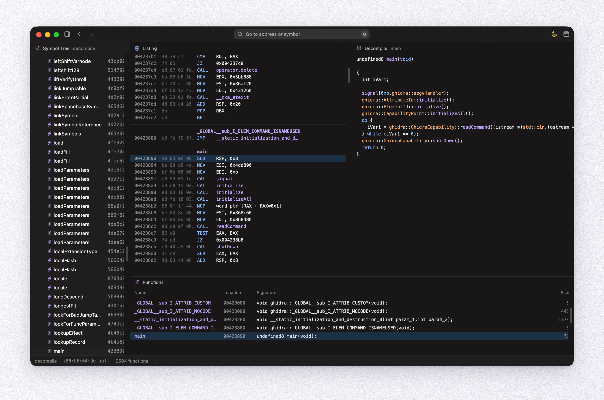

<p align="center">
  
</p>

<h1 align="center">rêve</h1>

<p align="center"><b>R</b>everse <b>E</b>ngineering <b>V</b>isual <b>E</b>nvironment</p>

<p align="center">Open-source reverse engineering application.</p>

<p align="center">
  
</p>

- `reve-engine/model/`: shared engine models.
- `reve-engine/ghidra-adapter/`: runs headless Ghidra and decodes its export into those models.
- `reve-ui/`: GPUI application.

Initial target: Linux ELF x86-64. Windows PE support may follow.

## Development tools

The parser uses **Ghidra 12.2** and **Eclipse Temurin JDK 25 (64-bit)**. 

From the repository root, run it with Python 3.9 or newer (macOS's built-in `python3` works):

```sh
python3 scripts/bootstrap.py
```

It downloads the Ghidra release and the latest Temurin 25 update for the current operating system and architecture, verifies their SHA-256 checksums, and extracts them under `.tools/`. It then builds Ghidra's native decompiler where the release ships none (Apple Silicon) and builds and installs the rêve Ghidra extension. Re-run it after changing `engine.proto`. Edits to `Export.java` apply on the next analysis.

The headless launcher is installed at:

- Windows: `.tools/ghidra/ghidra_12.2_PUBLIC/support/analyzeHeadless.bat`
- Linux/macOS: `.tools/ghidra/ghidra_12.2_PUBLIC/support/analyzeHeadless`

The bundled JDK is under `.tools/java/temurin-25/`. The parser can use these paths directly; no system-wide Java installation is required.

## Run the UI

Run `cargo run -p reve-ui` to start the GPUI application. Opening a binary analyzes it with the bundled Ghidra, so run `scripts/bootstrap.py` first.

Press `I` on the empty screen to pick a binary. Once Ghidra finishes, the workspace shows:

- Listing: every function's instructions with address, bytes, mnemonic and operands. Arrows or `j`/`k` step one instruction, page keys a page, `ctrl-d`/`ctrl-u` half a screen, and `enter` follows a call.
- Decompile: the cursor's function as Ghidra's C, colored by Ghidra's syntax classes. The lines the cursor's instruction became are marked and scrolled into view, and pressing a line moves the cursor to its instruction.
- Symbol Tree: every function by name. Unnamed `FUN_<address>` ones stay muted.
- Functions: every function in address order with its address, decompiled signature and size.

Pressing a function in Symbol Tree or Functions takes every pane to it.

Press `G` or click the field at the top to go to an address or a function by name. An address between instructions lands on the next one. `⌘[` and `⌘]` walk back and forward through jumps: following a call, picking a function, or going somewhere with Go To. Stepping through instructions doesn't count as a jump.

Press `⌘K` for every command on the current screen, with its shortcut. Type to narrow the list.

## TODO

`reve-model` doesn't carry these yet, so the UI leaves them out:

- Function plate comments
- Function namespaces
- Imports, by library
- Calls to imported functions
- End-of-line comments and the strings instructions load
- The program's start address

The Listing doesn't show function signatures yet, though the Functions window does.
